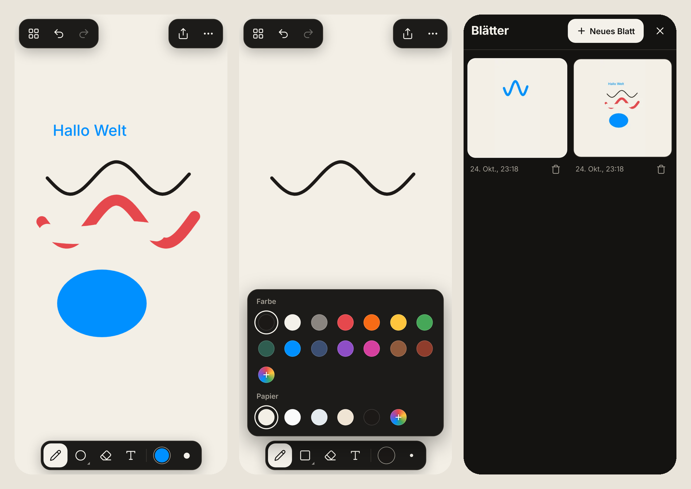

# Jotter

**Schnell zeichnen und Notizen kritzeln – auf Handy, Tablet und Computer.**
Kostenlos, ohne Konto, ohne Werbung. Funktioniert offline und lässt sich wie eine App installieren. Alles bleibt auf deinem Gerät.



👉 **Ausprobieren:** `https://<dein-name>.github.io/jotter/`

*[English below](#english)*

---

## Funktionen

- ✏️ **Stift** mit Druckempfindlichkeit (Apple Pencil, S Pen, Surface-Stift)
- ⬜ **Formen** – Linie, Viereck, Oval, wahlweise gefüllt
- 🧽 **Radierer** und **Text**
- 🎨 14 Farben + eigene Farbe, 5 Papierfarben + eigene
- 🔍 **Zoomen & Verschieben** mit zwei Fingern – Zeichnung wird beim Drehen des Handys nie verzerrt
- 📚 **Mehrere Blätter** mit Vorschau, automatisch gespeichert
- 📤 **Als Bild teilen/speichern** (PNG, automatisch auf die Zeichnung zugeschnitten)
- 📴 **Offline** nach dem ersten Besuch, **installierbar** auf dem Homescreen
- 🌍 Deutsch & Englisch (automatisch nach Gerätesprache)

## Gesten

| Geste | Wirkung |
|---|---|
| 1 Finger / Stift / Maus | zeichnen |
| 2 Finger ziehen / spreizen | verschieben / zoomen |
| 2-Finger-Tipp | rückgängig |
| 3-Finger-Tipp | wiederholen |
| aktives Werkzeug nochmal antippen | dessen Optionen (Stärke, Form) |
| Stift erkannt | Finger zeichnen nicht mehr, nur noch zoomen & schieben (Handballen-Erkennung). Umschaltbar im Menü „…“ |

**Tastatur:** `Strg/⌘+Z` rückgängig · `Strg/⌘+Umschalt+Z` wiederholen · `P` Stift · `S` Formen · `E` Radierer · `T` Text · `[` `]` Stärke · `0` Ansicht einpassen · `Leertaste`+Ziehen verschieben · `Umschalt` beim Formzeichnen: Quadrat/Kreis/45°

## Als App installieren

- **iPhone/iPad (Safari):** Teilen → „Zum Home-Bildschirm“
- **Android (Chrome):** Menü „…“ in Jotter → „Als App installieren“
- **Computer (Chrome/Edge):** Installieren-Symbol in der Adressleiste

## Datenschutz

Jotter hat **keinen Server**. Zeichnungen liegen nur im Browser-Speicher (IndexedDB) deines Geräts. Keine Cookies, kein Tracking, keine externen Schriften oder Skripte. Wer die App-Daten im Browser löscht, löscht auch die Zeichnungen.

---

## Entwickeln

Voraussetzung: [Node.js](https://nodejs.org) 20 oder neuer.

```bash
npm install
npm run dev        # Entwicklungsserver, auch im WLAN erreichbar (Handy testen)
npm run build      # Typprüfung + fertige App nach dist/
npm run preview    # dist/ lokal ansehen (inkl. Offline-Modus)
```

### Aufbau

```
index.html          Oberfläche (statisches HTML + Icon-Sprite)
src/main.ts         Bedienung: Werkzeuge, Menüs, Galerie, Speichern, Export
src/board.ts        Zeichenfläche: Ebenen, Ansicht/Zoom, Rückgängig
src/input.ts        Finger/Stift/Maus: Zeichnen, Gesten, Handballen-Erkennung
src/render.ts       Zeichnen der Striche, Formen, Texte
src/store.ts        Speicherung in IndexedDB
src/i18n.ts         Texte Deutsch/Englisch
src/sw.js           Offline-Service-Worker (wird beim Build befüllt)
src/styles.css      Aussehen
```

Keine Laufzeit-Abhängigkeiten – nur Vite und TypeScript zum Bauen. Die fertige App ist ca. **20 KB** (gzip).

### Warum es schnell ist

- Beim Zeichnen wird nur das **neue Stück** des Strichs gemalt, nie die ganze Zeichnung neu – auch nach Tausenden Strichen bleibt es flüssig.
- Papierfarbe ist CSS hinter der Zeichen-Ebene; der Radierer legt sie einfach frei.
- Sehr volle Blätter werden beim Zoomen per GPU verschoben und erst danach scharf neu gezeichnet.
- Nur sichtbare Striche werden gezeichnet; Bildschirmauflösung auf 2× begrenzt.
- Low-Latency-Canvas auf Android, Coalesced Pointer Events für feine Linien.

## Auf GitHub veröffentlichen

1. Neues Repository auf GitHub anlegen (z. B. `jotter`), diesen Ordner hochladen bzw. pushen:
   ```bash
   git init && git add . && git commit -m "Jotter"
   git branch -M main
   git remote add origin https://github.com/<dein-name>/jotter.git
   git push -u origin main
   ```
2. Im Repo: **Settings → Pages → Source: „GitHub Actions“**.
3. Fertig – nach ca. einer Minute läuft Jotter unter `https://<dein-name>.github.io/jotter/`.

Jeder weitere Push auf `main` aktualisiert die Seite automatisch; Nutzer bekommen in der App den Hinweis „Neue Version verfügbar“.

**Download-Paket:** Ein Tag wie `v1.0.0` pushen (`git tag v1.0.0 && git push --tags`) → unter *Releases* erscheint `jotter-web.zip`, das man auf jeden beliebigen Webspace hochladen kann.

## Lizenz

[MIT](LICENSE) – frei nutzbar, auch kommerziell. Icons: [Lucide](https://lucide.dev) (ISC).

---

<a id="english"></a>

## English

**Jotter** is a tiny, fast drawing & note app for phones, tablets and desktops. Free, no account, no ads, works offline, installable, and everything stays on your device.

- Pressure-sensitive pen, shapes (line/rect/oval, optional fill), eraser, text
- Two-finger pinch to zoom & pan; two-finger tap = undo, three-finger tap = redo
- Palm rejection once a stylus is detected
- Multiple sheets with thumbnails, auto-saved to IndexedDB
- Share/save as PNG, cropped to the drawing
- Offline service worker, installable PWA, German & English UI

```bash
npm install
npm run dev
npm run build   # → dist/
```

Deploy: push to `main`, then set **Settings → Pages → Source: GitHub Actions**. Tag `v*` to get a release with `jotter-web.zip`.

MIT licensed.
