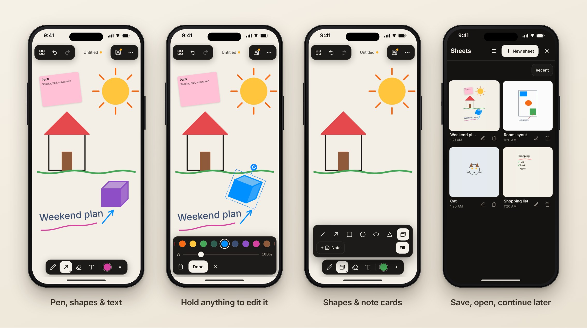

# Jotter

**Quick sketches and notes on your phone, tablet or computer.**
Free, no account, no ads. Works offline, installs like an app, and everything stays on your device.



🎬 [Watch the 50-second demo](docs/demo.mp4)

👉 **Try it:** https://elphax89.github.io/jotter/

---

## Features

- ✏️ **Pen** with pressure sensitivity (Apple Pencil, S Pen, Surface Pen)
- ⬜ **Shapes**: line, arrow, rectangle, circle, oval, triangle, cuboid, optionally filled
- 🔤 **Text**: drag it anywhere, rotate it, pick a colour and size
- 🗒️ **Note cards**: coloured cards with a title and text on top of your drawing, with adjustable opacity
- ✋ **Hold to edit**: hold any text, stroke, shape or note to move, rotate, recolour, resize or delete it
- 🧽 **Eraser**
- 🎨 14 ink colours + custom, 5 paper colours + custom
- 🔍 **Pinch to zoom and pan** with two fingers. The drawing never stretches when you rotate the phone.
- 📚 **Save and open sheets**: Open, Save (overwrite), Save as (new copy), Rename. Grid or list view with name and date, sortable and searchable.
- 🛟 **Nothing gets lost**: unsaved work is kept in the background and restored after a reload
- ⚙️ **Settings**: autosave, start in full screen, language, palm rejection
- ⬇️ **Download or share as image** (PNG, cropped to the drawing)
- 📴 **Offline** after the first visit, **installable** to the home screen
- 🌍 English and German (follows the device language, switchable in Settings)

## Saving and continuing later

| Action | What happens |
|---|---|
| **Save** (disk icon, top right) | Stores the sheet under its name and overwrites the last saved version. Asks for a name the first time. An orange dot means there are unsaved changes. |
| **Save as…** (menu “…”) | Stores a new copy under a new name. The original stays as it was last saved. |
| **Open** (grid icon, top left) | Shows all saved sheets as a grid or list with name and date. Tap one to continue drawing. |
| **Rename** | Tap the sheet name at the top, or the pencil icon in the list. |
| **Discard changes** (menu, only with changes) | Goes back to the last saved version. |

**Autosave** is off by default (Settings → Autosave). With it off, only sheets you saved show up in the list. Unsaved work is still kept in the background and comes back after a reload. When you switch to another sheet with unsaved changes, Jotter asks: Save, Discard or Cancel. If you delete the sheet that is currently open, the drawing stays on screen as an unsaved sheet.

## Text

1. Pick the **T** tool and tap the sheet. A dashed field appears; tap the text bar to type (the keyboard only opens then).
2. Choose **colour** and **size** in the bar. Drag the field to **move** it freely, use the blue handle to **rotate** it (snaps gently every 15°). The bar steps aside while you drag.
3. **Place** commits the text.

## Note cards

Shapes menu → **+ Note**: write a title and some text, and the card lands in the middle of the screen, ready to drag into place. While it’s selected (or later, after holding it) you can pick a card colour, resize it, rotate it, change its **opacity in 5% steps**, edit its text with the pencil button, or delete it.

## Hold to edit anything

Everything on the sheet can be changed later, whether it’s a text, a freehand stroke, a shape or a note card:

- **Hold** it for a moment (pen or shape tool; in the text tool for texts, where a tap shows a “Hold to select” hint). It lifts off the sheet and follows your finger.
- **Move** it by dragging, **rotate** it with the blue handle, change its **colour** and **size** in the bar, or **delete** it with the bin.
- **Done** (or a tap anywhere else) puts it back. Every change can be undone.

Drawing over existing lines works as usual; only holding still picks something up.

## Full screen

Jotter switches to full screen with your first tap (Settings → “Start app in full screen”, on by default). Browsers only allow full screen after a touch, so it can’t happen on load. iPhone browsers don’t support full screen at all; add Jotter to the home screen instead.

## Gestures

| Gesture | Action |
|---|---|
| 1 finger / pen / mouse | draw |
| 2 fingers drag / pinch | pan / zoom |
| 2-finger tap | undo |
| 3-finger tap | redo |
| Tap the active tool again | its options (size, shape) |
| Stylus detected | fingers stop drawing and only zoom and pan (palm rejection). Toggle in Settings. |

**Keyboard:** `Ctrl/⌘+S` save · `Ctrl/⌘+Shift+S` save as · `Ctrl/⌘+O` open · `Ctrl/⌘+Z` undo · `Ctrl/⌘+Shift+Z` redo · `P` pen · `S` shapes · `E` eraser · `T` text · `[` `]` size · `0` fit view · `Space`+drag to pan · `Shift` while drawing a shape: square / 45°

## Install as an app

- **iPhone / iPad (Safari):** Share → “Add to Home Screen”
- **Android (Chrome):** Jotter Settings → “Install as app”, or Chrome menu → “Install app”
- **Desktop (Chrome / Edge):** install icon in the address bar

## Privacy

Jotter has **no server**. Drawings live only in your browser’s storage (IndexedDB) on your device. No cookies, no tracking, no external fonts or scripts. Clearing the browser’s site data also deletes the drawings.

---

## Development

Requires [Node.js](https://nodejs.org) 20 or newer.

```bash
npm install
npm run dev        # dev server, reachable on your Wi-Fi for testing on a phone
npm run build      # type check + production build into dist/
npm run preview    # serve dist/ locally (including offline mode)
```

### Project layout

```
index.html          UI (static HTML + icon sprite)
src/main.ts         app logic: tools, menus, gallery, saving, text editing, export
src/board.ts        canvas: layers, view/zoom, undo history, previews
src/input.ts        finger / pen / mouse: drawing, gestures, palm rejection
src/render.ts       drawing strokes, shapes and text
src/store.ts        IndexedDB storage
src/i18n.ts         English / German strings
src/sw.js           offline service worker (filled in at build time)
src/styles.css      styles
```

No runtime dependencies, only Vite and TypeScript for building. The finished app is about **25 KB** gzipped.

### Why it’s fast

- While drawing, only the **new piece** of the stroke is painted, never the whole picture, so it stays smooth even after thousands of strokes.
- The paper colour sits on its own layer behind the ink; the eraser simply reveals it.
- Very full sheets are moved by the GPU while zooming and redrawn sharply afterwards.
- Only visible strokes are drawn; canvas resolution is capped at 2×.
- Coalesced pointer events give fine lines even with fast movements.

## Publish your own copy

1. Fork this repository, or create a new one and push this folder:
   ```bash
   git init && git add . && git commit -m "Jotter"
   git branch -M main
   git remote add origin https://github.com/Elphax89/jotter.git
   git push -u origin main
   ```
2. In the repo: **Settings → Pages → Source: “GitHub Actions”**.
3. Done. After about a minute Jotter runs at `https://elphax89.github.io/jotter/`.

Every push to `main` updates the site; users see a “New version available” notice in the app.

**Download package:** push a tag like `v1.0.0` (`git tag v1.0.0 && git push --tags`) and a `jotter-web.zip` appears under *Releases*, ready to upload to any web host.

## License

[MIT](LICENSE): free to use, including commercially. Icons: [Lucide](https://lucide.dev) (ISC).
